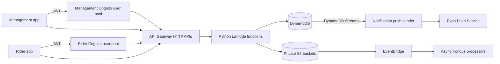

# Architecture
_Last updated: 2026-10-01_

## Purpose and ownership

`tour-data-api` is the serverless backend for the Cycling Tour Management Platform. It is the source of truth for API contracts, authorization, data storage, and AWS infrastructure for the entire platform. This includes both the management and rider Amazon Cognito user pools and the AWS resources used by the management and rider apps.

Deployments are isolated by AWS account and environment. The backend exposes authenticated API Gateway **HTTP APIs**; Lambda functions implement the business logic, DynamoDB stores structured data, and S3 stores private files.

## Request and event flow

The API Gateway JWT authorizers validate tokens from the corresponding Cognito pool. Lambda handlers enforce application permissions from `src/layers/common/rbac.py`; the authoritative group-to-permission mapping is in [RBAC](rbac.md). Lambda execution roles grant access to only the AWS resources required by each handler.

Management web hosting is owned by `tour-mgmt-app`; the backend only provides CORS through the `ManagementWebAllowedOrigins` parameter.

S3 presigned URLs are used for private file uploads and downloads. S3 object-created events can trigger asynchronous processing, such as hotel allocation CSV validation. Notification inbox writes can invoke the push sender through DynamoDB Streams.

## Data organization

The backend uses shared tables for platform-wide records and provisions a separate group of operational tables for each tour. See [Data model](data-model.md) for the table inventory and [API reference](api-reference.md) for the HTTP contracts.

## Implementation

- `template.yaml` is the primary AWS SAM/CloudFormation definition.
- `src/functions/` contains Lambda handlers organized by domain.
- `src/layers/common/` contains shared Python modules, including `checkin_service`, `event_engine`, `event_registration`, `event_self_service`, `handler_utils`, `notification_service`, `ownership`, `profile_schema`, `rbac`, `rider_identity`, `self_checkin_rules`, `self_service_policy`, and `tour_provisioning`.
- API Gateway handlers use the `api_handler` decorator from `handler_utils` as their outermost error boundary. Handlers catch only the exceptions they can map to a specific response (for example `ValidationError` to 400); any other exception is logged with its type and traceback and returned as the standard `INTERNAL_ERROR` (500) envelope. A handler that must act on every failure (for example, writing a failure audit record) does so in its own `except Exception` block and then re-raises.
- `samconfig.toml`, `Makefile`, `scripts/`, and `.github/workflows/ci-cd.yml` support environment configuration, local development, provisioning, and deployment.
- AWS service calls use the Python SDK (`boto3`), not the JavaScript AWS SDK.

## Related design

- [API reference](api-reference.md)
- [Data model](data-model.md)
- [RBAC](rbac.md)
- [Events and hotel logistics](events.md)
- [Notifications](notifications.md)
- [Tour artifacts](artifacts.md)
- [Rider profile schema](rider-profile-schema.md)
- [Dashboard API](dashboard-api.md)
