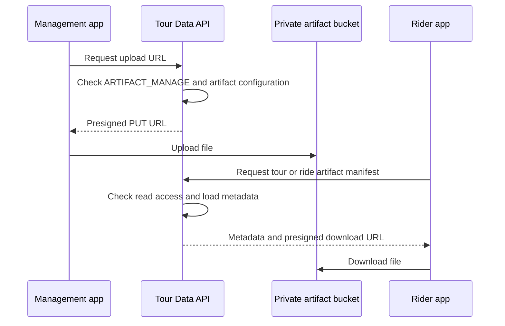

# Tour artifact design
_Last updated: 2026-09-29_

## Storage model

Artifact files are private S3 objects. The owning tour's `Artifacts-{tourId}` DynamoDB table stores metadata keyed by `artifactFor` and `artifactId`. `artifactFor` is the `tourId` for a tour artifact or `tourId#rideId` for a ride artifact. Artifact type identifiers and their `tour` or `ride` category are configured in shared `AppConfig` entries with `configType=ARTIFACTS`.

Object key patterns:

| Scope | S3 key pattern |
|---|---|
| Tour | `tours/{tourId}/{artifactId}.{extension}` |
| Ride | `tours/{tourId}/rides/{rideId}/{artifactId}.{extension}` |

Metadata includes the S3 key, content type, current version, file size, upload time and actor, and display title. Replacing an artifact updates its metadata version.

## Upload and read flow

The API validates the tour, ride (when applicable), configured artifact category, and supported content type before issuing a presigned URL. Artifact deletion removes the S3 object and the corresponding metadata item. Read endpoints can filter by `artifactId` and accept an expiry duration within the API's supported range.

The rider client may cache downloaded artifact files as an optimization; that does not imply general offline operation. The backend remains the authority for metadata, authorization, and URL generation.

## Security and ownership

- The artifact bucket is private; reads and writes use short-lived presigned URLs.
- Upload and delete operations require `ARTIFACT_MANAGE`.
- The management app is the intended artifact writer; authenticated clients with read access may request manifests.
- Rider profile photos use their separate profile-photo flow and are not stored in the tour artifact namespace.

See [API reference](api-reference.md#artifacts), [Data model](data-model.md), and [Artifacts requirements](../requirements/artifacts.md) for the contract, table inventory, and product requirements.
