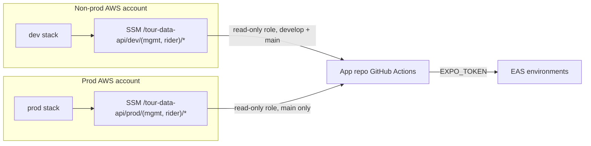

# Client app configuration handover
_Last updated: 2026-11-16_

## Purpose

The management app (`tour-mgmt-app`) and the rider app (`tour-rider-app`) need connection values that only exist after this backend is deployed: the API base URL, the Cognito user pool ID, the Cognito app client ID and the region. The backend publishes these values to AWS Systems Manager (SSM) Parameter Store in the same account as the stack. The app repositories read them from their own GitHub Actions pipelines and configure their EAS build environments. No values are copied by hand.

The values are public client configuration. They are bundled into the app binaries as `EXPO_PUBLIC_*` variables and must never include secrets.

## Flow

- `template.yaml` creates the parameters (`ClientConfig*Param` resources), so they are created, updated and deleted with the stack and always match it.
- The app repository owns the mapping from parameters to its `EXPO_PUBLIC_*` variables and EAS environments, including the Production app's reviewer routing to dev. The backend does not know Expo variable names.

## Parameter contract

Path: `/tour-data-api/<env>/<app>/<name>`, where `<env>` is the stack name (`dev`, `test`, `prod`) and `<app>` is `mgmt` or `rider`. Standard tier, type `String`.

| Name | `mgmt` value | `rider` value |
|---|---|---|
| `region` | Stack region | Stack region |
| `api-endpoint` | Management HTTP API base URL (`ApiEndpoint` output) | Rider HTTP API base URL (`RiderApiEndpoint` output) |
| `cognito-user-pool-id` | Management pool ID (auto-created, or taken from `CognitoUserPoolArn`) | Rider pool ID |
| `cognito-app-client-id` | Management app client ID (auto-created, or `CognitoAppClientId`) | Rider app client ID |

Contract rules:

- Paths and names are stable. Renaming or removing a parameter is a breaking change for the app repositories and must be agreed with them first.
- Adding a parameter is non-breaking. Add it under the relevant `<app>` folder.
- Values are public. Secrets (for example Expo push tokens under `/<env>/push/`) are never published under `/tour-data-api/`.
- The `test` stack also publishes its parameters, but no app read access is defined for it.

## Access model

| Role | Account | Reads | Trusted GitHub refs |
|---|---|---|---|
| `tour-data-api-mgmt-config-read-dev` | Non-prod | `/tour-data-api/dev/mgmt/*` | `tour-mgmt-app` `develop`, `main` |
| `tour-data-api-mgmt-config-read-prod` | Prod | `/tour-data-api/prod/mgmt/*` | `tour-mgmt-app` `main` |
| `tour-data-api-rider-config-read-dev` | Non-prod | `/tour-data-api/dev/rider/*` | `tour-rider-app` `develop`, `main` |
| `tour-data-api-rider-config-read-prod` | Prod | `/tour-data-api/prod/rider/*` | `tour-rider-app` `main` |

- The roles come from `cloudformation/consumer-read-access.yaml`, deployed manually by an administrator ([AWS Deploy Access Setup, Step 8](../guides/aws-deploy-access-setup.md#step-8-client-app-config-read-access)).
- The dev roles also trust `main` because each app's Production package routes the store reviewer account to the dev backend, so the Production build needs dev values.
- The roles allow only `ssm:GetParameter`, `ssm:GetParameters` and `ssm:GetParametersByPath` on their folder. The deploy roles in `deploy-access.yaml` can write only under `/tour-data-api/<env>/`.
- Trust uses exact `sub` matches, so app workflow jobs that assume these roles must not set a GitHub `environment:`.

## Operational notes

- The values change only when the underlying resource is replaced (stack recreation, or a Cognito/API change that requires replacement). `EXPO_PUBLIC_*` values are fixed at build time, so installed apps keep the old values until a new build is released.
- A dev change affects both app packages: the Dev package, and the Production package's reviewer routing.
- Standard SSM parameters have no storage charge. Reads by the app pipelines use the standard throughput at no additional charge.

## Related

- [Architecture](architecture.md)
- [AWS Deploy Access Setup](../guides/aws-deploy-access-setup.md)
- [Deployment](../guides/deployment.md)
