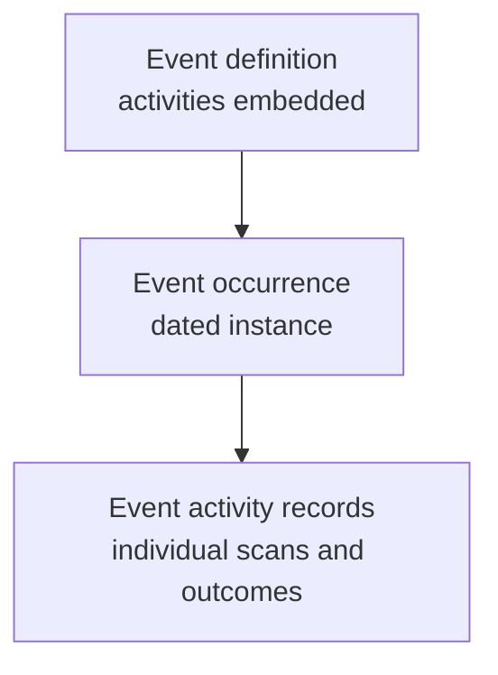

# Events and hotel logistics
_Last updated: 2026-10-01_

The backend event engine extends ride check-ins to non-ride tour activities. It is configuration-driven: event and activity labels, ordering, scan types, optional variants, prerequisites, and occurrence-specific adjustments are data rather than hard-coded workflow branches.

## Event hierarchy

An event definition is stored in `Event-{tourId}`. Its ordered activities are embedded in the definition item. A dated instance is stored separately in `EventOccurrence-{tourId}`. Individual activity records are stored in `EventActivityLogs-{tourId}`. Keeping definition and occurrence records separate allows their distinct authorization and lifecycle rules to be applied consistently.

## Configuration and behavior

- Event and activity definitions are editable as tour data. Initial event definitions are not required by the backend schema; event content is configured for a tour.
- Event definitions include `registrationEnabled` and `selfServiceAllowed`, both defaulting to `false`. With registration disabled, every rider on the tour except `EXITED`/`WITHDRAWN` is considered registered; when enabled, riders register while the occurrence is `PLANNED`.
- Self-service permission resolves per activity by occurrence activity override → occurrence → activity → event → `false`. An explicit `null` for occurrence `selfServiceAllowed` on create/update leaves it unset or removes the existing value; `null` for an activity override also clears that level and resumes inheritance.
- Scan types are configured through `AppConfig` `ID_CODE_TYPE` values. Event-level defaults may be narrowed by each activity's `allowedTypeCodes`.
- Occurrences support `selfServiceAllowed` plus per-activity overrides for enabled state, self-service, allowed type codes, skip state, and an explanatory note.
- Activity records preserve the event/activity identity and scan-time details for history. Sequence, prerequisite, assignment, and allowed-type rules are enforced by the backend.
- Rider self-records use method `SELF_SERVICE`, derive rider identity from the Rider API login, omit `typeCode`, and reuse shared record validation/cancellation logic. Registration blocks staff and rider activity recording when enabled and the rider is unregistered.
- `EventRegistration-{tourId}` stores occurrence/rider registrations with timestamp, actor, and `RIDER`/`STAFF` source. It is provisioned, archived, and deleted with the tour.
- Event activity records use the existing rider personal-code/ID-code lookup model; a separate baggage identity is not introduced.
- Hotel master records are in `Hotel-{tourId}`. `RoomAllocation-{tourId}` stores one rider allocation per stay date, including room-sharing information.
- Hotel allocation CSV files are uploaded through a presigned S3 URL and processed asynchronously. The processor validates the entire file before applying changes; invalid files are rejected without partial allocation writes. Clients can check processing state through the upload-status API.
- Baggage custody is distinct from rider tour participation. `ACTIVE`, `RETAINED`, and `WITH_RIDER` communicate whether baggage remains with organizers; baggage scans for baggage no longer in organizer custody are rejected.

The `/v1/tours/{tourId}/events/bootstrap` endpoint supplies event-related data for client startup. This is a data-loading API and does not describe an offline capability in either client app.

## Authorization

The backend permissions are `EVENT_MANAGE`, `EVENT_OCCURRENCE_MANAGE`, `EVENT_REGISTRATION_MANAGE`, `EVENT_SCAN`, `SELF_CHECKIN`, and `HOTEL_ALLOC_MANAGE`. `SELF_CHECKIN` is Rider API only; the permission-to-group mapping and assignment checks are defined in [RBAC](rbac.md) and enforced in `src/layers/common/rbac.py`.

## Related contracts

- API methods, request fields, responses, validation, and errors: [API reference](api-reference.md#events) and [Hotels](api-reference.md#hotels)
- Shared and tour-specific table inventory: [Data model](data-model.md)
- Notification triggers for event completion and reminders: [Notifications](notifications.md)
- Event business requirements: [Events requirements](../requirements/events.md)
