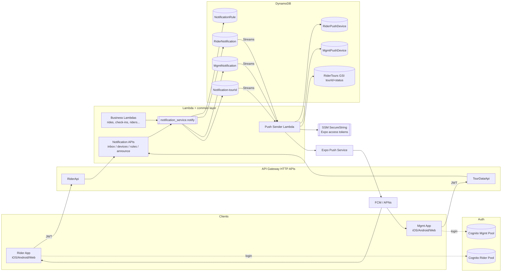
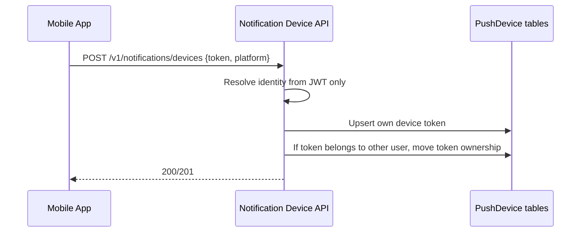
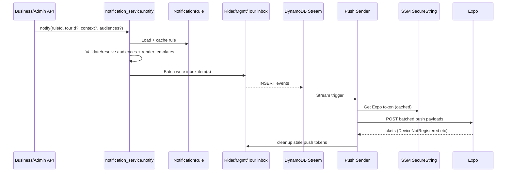
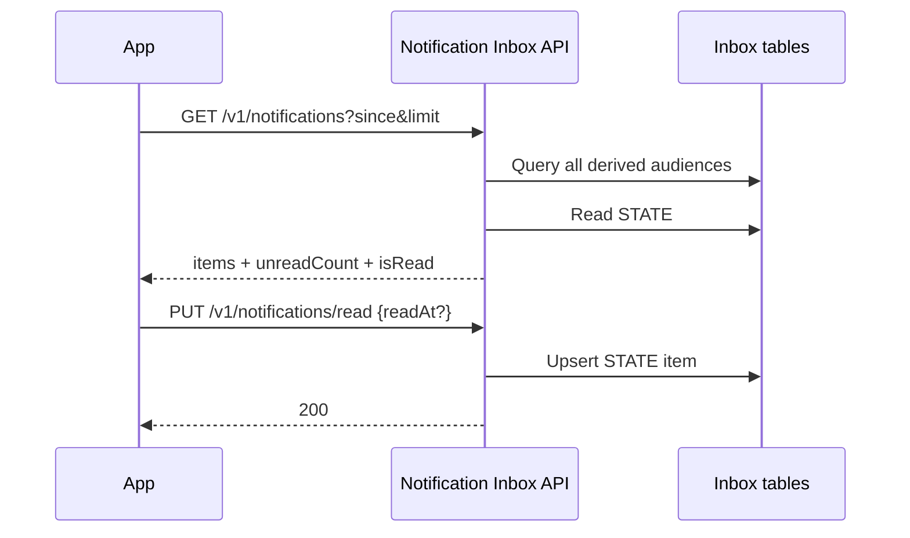

# Notification Framework Design

This document defines the approved notification framework for `tour-data-api`. It is the backend source of truth for notification data model, routing, APIs, and push delivery.

## 1) Architecture



## 2) Sequence diagrams

### 2.1 Device registration



### 2.2 Notify + push



### 2.3 Inbox read/unread



## 3) Data model

### 3.1 Shared SAM tables

1. **NotificationRule** (`{Stack}-NotificationRule`) PK `ruleId`
2. **RiderNotification** (`{Stack}-RiderNotification`) PK `audience`, SK `sk=<createdAt>#<notificationId>`
3. **MgmtNotification** (`{Stack}-MgmtNotification`) PK `audience`, SK `sk=<createdAt>#<notificationId>`
4. **RiderPushDevice** (`{Stack}-RiderPushDevice`) PK `profileId`, SK `token`
5. **MgmtPushDevice** (`{Stack}-MgmtPushDevice`) PK `cognitoSub`, SK `token`, with GSI `GroupKeyIndex(groupKey, updatedAt)` using one lightweight per-group index item approach.

All tables use PAY_PER_REQUEST, SSE enabled, and standard deployment tags including `SubscriptionId`.

### 3.2 Tour table redesign

`Notification-{tourId}` is redesigned to the same inbox schema:
- PK: `audience`
- SK: `sk`
- TTL attribute: `expiresAt` (epoch seconds)
- Stream: `NEW_IMAGE`

Legacy `readBy` and old `TypeCreatedAtIndex` are removed.

### 3.3 RiderTours index

`RiderTours` adds GSI `TourStatusIndex`:
- PK `tourId`
- SK `status`

Used for status/applicant audience fan-out.

## 4) Audience expression support

| Expression | Recipients | Stored in |
|---|---|---|
| `ALL` | all users of both apps | RiderNotification (`APP#RIDER`) + MgmtNotification (`APP#MGMT`) |
| `APP#RIDER` | all rider app users incl. profile-only | RiderNotification |
| `APP#MGMT` | all mgmt users | MgmtNotification |
| `PROFILE#<profileId>` | one rider | RiderNotification |
| `USER#<cognitoSub>` | one staff user | MgmtNotification |
| `GROUP#<group>` | staff Cognito group | MgmtNotification |
| `TOUR#<t>#STATUS#<s>` | riders with RiderTours status s | RiderNotification |
| `TOUR#<t>#APPLICANTS` | any RiderTours record for t | RiderNotification |
| `TOUR#<t>#ALL` | registered riders + staff of tour | Notification-{t} |
| `TOUR#<t>#APP#RIDER` / `TOUR#<t>#APP#MGMT` | registered riders / staff of tour | Notification-{t} |
| `TOUR#<t>#GROUP#<g>` | staff group within tour | Notification-{t} |
| `TOUR#<t>#RIDER#<riderId>` | one registered rider | converted to `PROFILE#<profileId>` and stored in RiderNotification |

Unknown forms are rejected by strict regex validation.

## 5) API contract

### 5.1 Device APIs
- `POST /v1/notifications/devices`
- `DELETE /v1/notifications/devices/{token}`

### 5.2 Inbox APIs
- `GET /v1/notifications?since=<ISO>&limit=<n>`
- `GET /v1/notifications/unread-count`
- `PUT /v1/notifications/read`

### 5.3 Announce API (management)
- `POST /v1/notifications` with `NOTIFICATION_MANAGE`

### 5.4 Admin rule CRUD
- `GET/POST/PUT/DELETE /v1/admin/notification-rules[/{ruleId}]` with `NOTIFICATION_MANAGE`

## 6) Common layer service

`notification_service.notify(rule_id, tour_id=None, context=None, audience_override=None, actor=None) -> str | None`

Behavior:
1. Load rule with 5-minute in-memory cache.
2. Respect `enabled`; return `None` if missing/disabled.
3. Allow overrides only when `allowOverride=true`.
4. Render templates safely; missing keys do not raise.
5. Route/write inbox records with TTL from `ttlHours`.
6. Never raise to caller; log structured error and return `None`.

## 7) Push sender

- Stream trigger from RiderNotification, MgmtNotification, and tour notification tables.
- Filters INSERT + `push=true`, skips `STATE` items.
- Resolves recipients by audience expression.
- Sends Expo payload in batches of 100 using `urllib`.
- Reads bearer tokens from SSM SecureString parameters (`/{stack}/push/expo-token/rider` and `/{stack}/push/expo-token/mgmt` by default).
- Missing token parameter is tolerated (log + skip).
- Immediate ticket errors handled; `DeviceNotRegistered` tokens are removed.
- Retry strategy: stream retries + SQS DLQ + CloudWatch alarm.
- Receipt polling is deferred to a future scheduled enhancement.

## 8) Trigger points

Business handlers should call `notify()` non-blocking for:
- `RIDE_OPENED`
- `RIDE_STARTED`
- `RIDE_CLOSED`
- `PIT_STOP_OPENED`
- `PIT_STOP_CLOSED`
- `RIDER_EXITED` (personal)
- `REGISTRATION_STATUS_CHANGED` (personal)
- `HOTEL_ALLOCATION_PUBLISHED` (when applicable)

Rules not seeded are no-op.

## 9) Default seed rule

`ANNOUNCEMENT` rule (seeded):

```json
{
  "ruleId": "ANNOUNCEMENT",
  "enabled": true,
  "category": "ANNOUNCEMENT",
  "audiences": ["ALL"],
  "titleTemplate": "{title}",
  "bodyTemplate": "{message}",
  "push": true,
  "priority": "NORMAL",
  "androidChannel": "general",
  "target": { "screen": "Notifications", "paramKeys": [] },
  "ttlHours": 168,
  "allowOverride": true,
  "version": 1
}
```

## 10) Sample rule IDs for backend trigger hooks

```json
[
  {"ruleId":"RIDE_OPENED","category":"SYSTEM","audiences":["TOUR#{tourId}#ALL"]},
  {"ruleId":"RIDE_STARTED","category":"ALERT","audiences":["TOUR#{tourId}#ALL"],"priority":"URGENT","androidChannel":"urgent"},
  {"ruleId":"RIDE_CLOSED","category":"SYSTEM","audiences":["TOUR#{tourId}#ALL"]},
  {"ruleId":"PIT_STOP_OPENED","category":"SYSTEM","audiences":["TOUR#{tourId}#ALL"]},
  {"ruleId":"PIT_STOP_CLOSED","category":"SYSTEM","audiences":["TOUR#{tourId}#ALL"]},
  {"ruleId":"RIDER_EXITED","category":"PERSONAL","audiences":["PROFILE#{profileId}"]},
  {"ruleId":"REGISTRATION_STATUS_CHANGED","category":"PERSONAL","audiences":["PROFILE#{profileId}"]},
  {"ruleId":"HOTEL_ALLOCATION_PUBLISHED","category":"SYSTEM","audiences":["TOUR#{tourId}#APP#RIDER"]}
]
```

## 11) Cost note

Design remains low cost (DynamoDB on-demand + Lambda + API Gateway + Expo push), with expected notification overhead still in the <$1–2 per-tour range for this scale.
